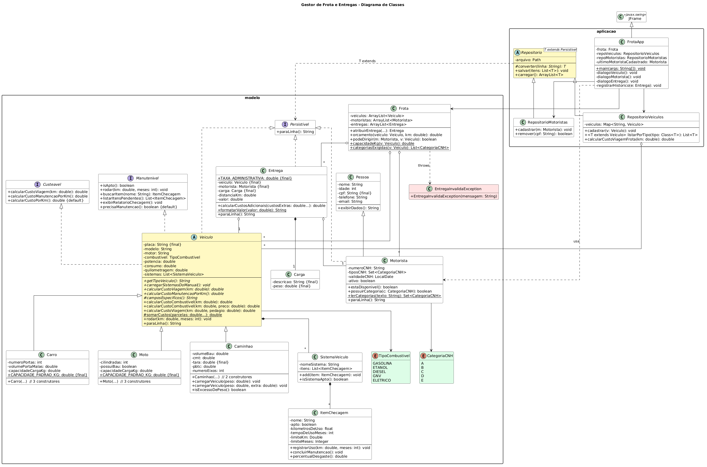

# 🚚 Gestor de Frota e Entregas

Sistema desktop em **Java (Swing)** para gerenciar uma frota de veículos de entrega: cadastro de veículos e motoristas, controle de manutenção, cálculo de custos de viagem e registro de entregas, com os dados salvos em arquivos de texto.

> **Projeto acadêmico** desenvolvido para a disciplina de **Programação Orientada a Objetos (POO)**. O foco do trabalho é aplicar os conceitos de orientação a objetos pedidos pelo professor. Cada requisito está indicado no código com um comentário `// N:` e mapeado no arquivo [`localRequisitos.md`](localRequisitos.md).

---

## Sumário

- [Funcionalidades](#funcionalidades)
- [Conceitos de POO aplicados](#conceitos-de-poo-aplicados)
- [Arquitetura](#arquitetura)
- [Diagrama de classes](#diagrama-de-classes)
- [Regras de negócio](#regras-de-negócio)
- [Persistência](#persistência)
- [Como executar](#como-executar)
- [Estrutura de pastas](#estrutura-de-pastas)
- [Equipe](#equipe)

---

## Funcionalidades

A interface tem uma barra lateral com cinco páginas:

| Página | O que faz |
|---|---|
| **Painel** | Indicadores da frota (veículos, motoristas, veículos que precisam de manutenção, receita total), saúde de cada veículo e últimas entregas. |
| **Veículos** | Cadastro de **carros**, **motos** e **caminhões**; tabela com km rodados, carga máxima, itens pendentes e status; checklist de manutenção por sistema (freio, elétrico, pneus...). |
| **Motoristas** | Cadastro com validação de CPF, CNH (número, categorias e validade) e e-mail; mostra para quais tipos de veículo o motorista está habilitado. |
| **Entregas** | Criação de uma entrega escolhendo veículo e motorista, com **orçamento calculado na hora**; histórico de entregas realizadas. |
| **Removidos** | Registro de veículos e motoristas removidos, com data/hora e detalhes. |

A entrada de dados é feita por **caixas de diálogo** (`JOptionPane`).

---

## Conceitos de POO aplicados

Resumo dos requisitos da disciplina e onde aparecem. A lista completa, com link para cada linha do código, está em [`localRequisitos.md`](localRequisitos.md).

| # | Requisito | Onde está |
|---|---|---|
| 1.1 | Encapsulamento (atributos `private`) | Todas as classes de `modelo` e `aplicacao` |
| 1.2 | Atributos `String`, `int` e `float` na mesma classe | `ItemChecagem` |
| 1.3 | Atributo do tipo de uma enumeração | `Veiculo.combustivel` (`TipoCombustivel`), `Motorista.tiposCNH` (`CategoriaCNH`) |
| 1.4 | Atributo `ArrayList` | `Frota` (veículos, motoristas e entregas) |
| 1.5 | Constante em classe concreta usada em outra classe | `Entrega.TAXA_ADMINISTRATIVA` (usada em `Frota`), `Carro/Moto.CAPACIDADE_PADRAO_KG` |
| 2.1 | Método com varargs | `Veiculo.somarCustos(double...)`, `Entrega.calcularCustosAdicionais(double...)` |
| 2.2 | Método estático | `Veiculo.somarCustos`, `Frota.capacidadeKg`, `Entrega.formatarValor`, `Motorista.lerCategorias` |
| 3 | Construtores declarados | `Veiculo`, `Carro`, `Moto`, `Caminhao`, `Pessoa`, `Motorista`, `Entrega`, `Carga`... |
| 4 | Composição | `Entrega` cria sua própria `Carga` no construtor |
| 5 | Agregação | `Entrega` recebe `Veiculo` e `Motorista`, que existem independentemente dela |
| 6.1 | Atributo `final` em superclasse concreta | `Pessoa.cpf` |
| 6.2 | Acoplamento dinâmico | `FrotaApp` usa um `Motorista` para chamar `exibirDados()`, definido só em `Pessoa` |
| 7.1 | Polimorfismo de sobrecarga | Construtores de `Veiculo`/`Carro`/`Moto`/`Caminhao`, `calcularCustoViagem`, `calcularCustoCombustivel`, `carregarVeiculo` |
| 7.2 | Polimorfismo de coerção (cast explícito) | `ItemChecagem` (`(float)` sobre um `double`) |
| 7.3 | Polimorfismo de subtipagem | `Pessoa` → `Motorista` (ambas concretas) |
| 7.4 | Polimorfismo paramétrico | `RepositorioVeiculos.<T>listarPorTipo(Class<T>)`, chamado como `repo.<Carro>listarPorTipo(...)` |
| 8 | Interfaces | `Custeavel`, `Manutenivel` e `Persistivel`; `Veiculo` implementa as três |
| 9 | Exatamente dois pacotes | `modelo` e `aplicacao` |
| 10 | Classes abstratas | `Veiculo` e `Repositorio<T>` |
| 11 | Exceção própria | `EntregaInvalidaException`: lançada em `Frota.atribuirEntrega()` e tratada em `FrotaApp` |
| 12 | Entrada por caixas de diálogo | Formulários de veículo, motorista e entrega (`JOptionPane`) |
| 13 | Persistência em arquivo | `Repositorio<T>` + arquivos `.txt` (veja [Persistência](#persistência)) |

---

## Arquitetura

O projeto tem **dois pacotes**, como pede o requisito 9:

### `modelo`: domínio e regras de negócio

- **`Veiculo`** *(abstrata)*: dados comuns (placa, modelo, combustível, consumo, quilometragem) e a lista de sistemas de manutenção. Implementa `Custeavel`, `Manutenivel` e `Persistivel`.
  - **`Carro`**, **`Moto`** e **`Caminhao`**: cada um tem seu próprio manual de manutenção (`carregarSistemasDoManual()`), sua fórmula de custo e seus atributos (portas, cilindradas, eixos, tara, CMT...).
- **`SistemaVeiculo`** e **`ItemChecagem`**: um veículo tem vários sistemas (freio, elétrico, pneus...), e cada sistema tem itens com limite de **km** e de **meses**. O item é reprovado sozinho quando passa de um dos limites.
- **`Pessoa`** → **`Motorista`**: dados pessoais com validação; o motorista acrescenta CNH, categorias (`CategoriaCNH`) e situação (ativo / CNH vencida).
- **`Entrega`** e **`Carga`**: uma entrega liga um veículo e um motorista a uma carga, com distância e valor.
- **`Frota`**: guarda veículos, motoristas e entregas e valida cada entrega antes de criá-la.
- **Enums**: `TipoCombustivel` (com unidade e preço de referência) e `CategoriaCNH` (A, B, C, D, E).
- **Interfaces**: `Custeavel` (custos), `Manutenivel` (checagem e manutenção) e `Persistivel` (conversão para linha de texto).
- **`EntregaInvalidaException`**: exceção verificada para entregas inválidas.

### `aplicacao`: interface gráfica e persistência

- **`FrotaApp`**: janela principal em Swing (classe com o `main`).
- **`Repositorio<T extends Persistivel>`** *(abstrata e genérica)*: lê e grava qualquer objeto `Persistivel` em arquivo texto.
  - **`RepositorioVeiculos`** e **`RepositorioMotoristas`**: transformam cada linha do arquivo de volta em objeto (`converter`).

---

## Diagrama de classes



Versão vetorial: [`diagramas/diagrama.svg`](diagramas/diagrama.svg)

---

## Regras de negócio

- **Custo de viagem** = combustível + desgaste:
  - Combustível: `(km / consumo) × preço de referência` do `TipoCombustivel`.
  - Desgaste por km: carro **R$ 0,15**, moto **R$ 0,08**, caminhão **R$ 0,60 + R$ 0,10 por eixo**.
- **Orçamento da entrega** = custo da viagem × (1 + `TAXA_ADMINISTRATIVA` de 10%).
- **Capacidade de carga**: caminhão = `CMT − tara`; carro e moto usam a capacidade cadastrada (padrão de 500 kg e 30 kg).
- **Habilitação exigida**: moto → categoria **A**; carro → **B**; caminhão → **C** ou **E**.
- **Uma entrega só é criada se**:
  1. peso e distância forem maiores que zero;
  2. o veículo estiver apto (nenhum item de manutenção pendente);
  3. a carga couber na capacidade do veículo;
  4. o motorista estiver ativo, com CNH válida e na categoria certa.

  Se alguma regra falhar, é lançada uma `EntregaInvalidaException` e a mensagem aparece para o usuário.
- Depois da entrega, a distância é somada ao odômetro do veículo e ao desgaste dos itens de manutenção.

> Os preços e taxas são **ilustrativos**, definidos só para o trabalho.

---

## Persistência

Os dados ficam em arquivos `.txt` (campos separados por `;`), criados na pasta de onde o programa é executado:

| Arquivo | Conteúdo |
|---|---|
| `veiculos.txt` | Veículos cadastrados, incluindo quilometragem e estado de cada item de manutenção |
| `motoristas.txt` | Motoristas cadastrados |
| `historico.txt` | Entregas realizadas |
| `removidos.txt` | Registro de veículos e motoristas removidos |

Ao abrir, o sistema lê esses arquivos e reconstrói a frota. Linhas inválidas são ignoradas.

---

## Como executar

### Pré-requisitos

- **JDK 26 ou superior** (o `pom.xml` usa `maven.compiler.release = 26`)
- Opcional: **Maven** ou **Apache NetBeans**

### Pelo terminal (só com o JDK)

```bash
git clone https://github.com/MarioViniciux/gestorFrota.git
cd Gestor-de-Frota-e-Entrega---POO

javac -d target/classes $(find src/main/java -name "*.java")
java -cp target/classes com.mycompany.gestorfrotaentrega.aplicacao.FrotaApp
```

### Com Maven

```bash
mvn compile
java -cp target/classes com.mycompany.gestorfrotaentrega.aplicacao.FrotaApp
```

### Com NetBeans

Abra a pasta do projeto (*File → Open Project*), defina `FrotaApp` como classe principal e rode com **F6**.

---

## Estrutura de pastas

```
Gestor-de-Frota-e-Entrega---POO/
├── diagramas/
│   ├── diagrama.png
│   └── diagrama.svg
├── src/main/java/com/mycompany/gestorfrotaentrega/
│   ├── aplicacao/
│   │   ├── FrotaApp.java              # interface gráfica (main)
│   │   ├── Repositorio.java           # repositório genérico abstrato
│   │   ├── RepositorioMotoristas.java
│   │   └── RepositorioVeiculos.java
│   └── modelo/
│       ├── Veiculo.java               # classe abstrata
│       ├── Carro.java · Moto.java · Caminhao.java
│       ├── SistemaVeiculo.java · ItemChecagem.java
│       ├── Pessoa.java · Motorista.java
│       ├── Frota.java · Entrega.java · Carga.java
│       ├── Custeavel.java · Manutenivel.java · Persistivel.java
│       ├── TipoCombustivel.java · CategoriaCNH.java
│       └── EntregaInvalidaException.java
├── localRequisitos.md                 # índice: requisito → linha do código
└── pom.xml
```

---

## Equipe

| Integrante | GitHub |
|---|---|
| Mario Vinicius | [@MarioViniciux](https://github.com/MarioViniciux) |
| Natanael da Silva Carvalho | [@natanscarv](https://github.com/natanscarv) |
| Emily | [@emilyysd](https://github.com/emilyysd) |
| Lívia Guirra | [@livia-guirra](https://github.com/livia-guirra) |

---

<p align="center">Projeto acadêmico · Programação Orientada a Objetos</p>
